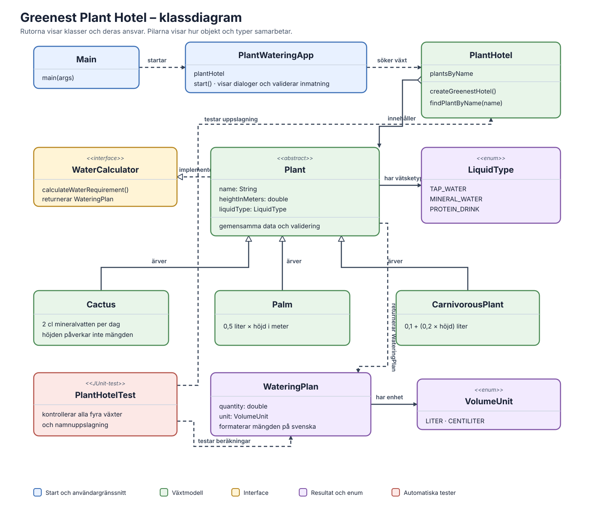

# Greenest Plant Hotel

Ett litet Java-program som hjälper växthotellet Greenest att räkna ut hur
mycket vätska varje växt behöver per dag. Skriv in växtens namn i en dialogruta
så visar programmet rätt mängd och vätsketyp.

## Funktioner

- Beräknar vätskebehov för hotellets fyra växter.
- Visar mängd, måttenhet och vätsketyp på svenska.
- Hanterar tomma svar, felaktiga tecken och växtnamn som inte finns.
- Låter användaren försöka igen efter ett fel.
- Innehåller automatiska JUnit-tester för beräkningar och namnuppslagning.

## Exempel på resultat

| Växt | Höjd | Vätska per dag |
|---|---:|---|
| Igge (kaktus) | 0,2 m | 2 cl mineralvatten |
| Laura (palm) | 5 m | 2,5 liter kranvatten |
| Meatloaf (köttätande växt) | 0,7 m | 0,24 liter proteindryck |
| Olof (palm) | 1 m | 0,5 liter kranvatten |

## Kom igång

### Förutsättningar

- Java Development Kit (JDK) 17 eller senare
- Apache Maven

### Starta programmet

Öppna ett terminalfönster i projektmappen och kör:

```bash
mvn compile
java -cp target/classes Main
```

Den första raden kompilerar programmet. Den andra startar det och visar
dialogrutan. En grafisk skrivbordsmiljö krävs för att dialogrutorna ska synas.

Du kan också öppna projektet i IntelliJ IDEA och köra `Main`.

### Kör testerna

```bash
mvn test
```

Maven kompilerar koden och kör JUnit-testerna. Om ett test misslyckas visas
vilket test som inte fick det förväntade resultatet. Testerna finns i
`test/PlantHotelTest.java`.

## Beräkningsregler

- **Palmer:** 0,5 liter kranvatten per meter höjd och dag.
- **Köttätande växter:** 0,1 liter proteindryck som bas, plus 0,2 liter per
  meter höjd och dag.
- **Kaktusar:** 2 cl mineralvatten per dag, oavsett höjd.

## Struktur

```text
src/                       Programmets Java-källkod
test/                      Automatiska JUnit-tester
pom.xml                    Maven-konfiguration och JUnit-beroende
README.md                  Projektbeskrivning och instruktioner
```

Växtklasserna ärver gemensamma egenskaper från `Plant` och räknar ut sitt
vätskebehov var för sig. `PlantWateringApp` hanterar dialogerna och
`PlantHotel` ansvarar för växtregistret.

## Klassdiagram

Diagrammet är en SVG-bild med fast layout och färger, så text och pilar
förblir tydliga oavsett om GitHub visas med ljust eller mörkt tema.



Blå rutor visar programmets start och användargränssnitt. Gröna rutor visar
växtregistret och växtklasserna. Den gula rutan är beräkningsinterfacet och
lila rutor visar resultat och enum-typer. Heldragna pilar med öppen triangel
visar arv; den streckade pilen med öppen triangel visar interface-
implementation. Övriga pilar visar att en klass använder eller innehåller en
annan.

## Teknik

- Java 17
- Maven
- JUnit 5
- Swing (`JOptionPane`) för dialogrutorna

## Skärmbilder

**Fråga efter växt:**


**Resultat för Igge:**


**Exempel på felmeddelande:**

